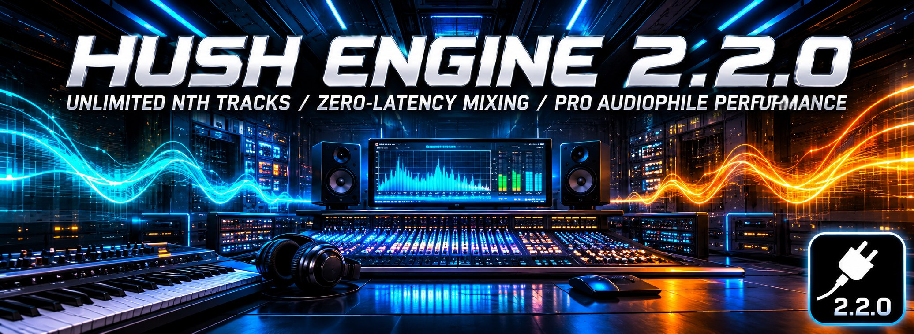

Copyright © 2026 Lewis James Seals Jr. All rights reserved.
THE SOFTWARE IS PROVIDED "AS IS", WITHOUT WARRANTY OF ANY KIND,
EXPRESS OR IMPLIED, INCLUDING BUT NOT LIMITED TO THE WARRANTIES OF
MERCHANTABILITY, FITNESS FOR A PARTICULAR PURPOSE AND
NONINFRINGEMENT.



# HUSH 2.2.0 — private, offline-first C++20 audio workstation (early development release)

HUSH is an offline-first C++20 audio application with a WAV/session core, a native Linux/X11 arrangement UI, a real-time float mixer callback, an optional system PortAudio output backend, session editing APIs, local forensics, and experimental watermark tools. It is **not yet a production-complete DAW**: the current GUI is an early Linux/X11 implementation, MIDI is an event queue rather than a hardware MIDI subsystem, and plugin hosting is an in-process DSP interface rather than a VST3/CLAP/AU binary host.

## Implemented in this tree

| Area | Current capability | Limitations |
|---|---|---|
| Audio files | WAV import: PCM 8/16/24/32-bit and IEEE float32; atomic PCM16 WAV export; tone, gain, mix and stats | No FLAC/AIFF/MP3; large WAVs require memory proportional to file size |
| Session editing | Track/clip model; v1 and v2 session reader; v2 stores source trim, clip length, fades; tested move/trim/split/fade APIs; bounded snapshot undo/redo | Clip-edit operations are library APIs, not all exposed as GUI tools; GUI edits gain/mute only |
| Offline render | Track gain/mute, volume/mute automation, clip trim and fades | Pan/send/plugin automation is stored but not rendered |
| Real-time mixer | Preloaded audio; bounded callback loop; no callback allocations; transport, seek, track gain/mute, master gain and peak meter | Playback only; no recording/monitoring or device hot-plug recovery yet |
| Linux device output | Optional system PortAudio backend; default output device; no dependency downloads | Physical hardware output was not exercised in this environment; GUI currently uses default output, not a device chooser |
| GUI | Native X11 window: transport, timeline, clip waveform overview, track rows, mixer gain, mute, peak meter, Ctrl+S, Ctrl+Z, Ctrl+Y | Linux/X11 only in this release; no clip drag/split UI, zoom/scroll, plugin panels, accessibility pass or multi-platform GUI |
| MIDI | Validated channel-voice event type and fixed-capacity SPSC queue | No OS MIDI device enumeration/input/output, note editor, or MIDI track UI |
| Plugins | In-process DSP plugin contract and prepared plugin chain | No untrusted binary loading, VST3/CLAP/AU SDK integration, sandboxing or third-party plugin compatibility claim |
| Forensics | Local, read-only DawChecker-derived detectors and HUSH-native indicators | Findings are indicators, not proof; calibration uses a synthetic corpus |
| Watermark | Explicit offline detect/embed with label file | Experimental; robustness and audibility remain limited/unverified |
| Privacy | No telemetry, updater, remote control, or network client in the active HUSH build; optional tools excluded | No independent security certification or full network-isolation certification claimed |

## Build (offline)

Requirements: CMake 3.16+ and a C++20 compiler. The optional X11 GUI is built when X11 is installed. The PortAudio hardware backend is **disabled by default**. After approving your system audio stack, opt in with `-DHUSH_ENABLE_PORTAUDIO=ON`; CMake only discovers a system-installed library and never downloads it. PortAudio may use a system-configured JACK/remote-audio endpoint, so enabling it is an explicit trust decision. To build without optional backends:

```sh
cmake -S . -B build -DCMAKE_BUILD_TYPE=Release \
  -DHUSH_WARNINGS_AS_ERRORS=ON -DHUSH_ENABLE_PORTAUDIO=OFF -DHUSH_BUILD_X11_GUI=OFF
cmake --build build --parallel 2
ctest --test-dir build --output-on-failure
```

The verified builds in this release are Linux x86-64 with GCC 14.2 and Clang 17. Windows/macOS/ARM are not verified. See `BUILD_TEST_RESULTS.txt` and `SECURITY_AND_PRIVACY.md` for exact scope and gaps.

## Run

```sh
hush help
hush tone /tmp/test.wav 1 440 0.25 48000 2
hush session-new /tmp/song.fks 48000 120
hush session-add-track /tmp/song.fks Vocals
hush session-add-clip /tmp/song.fks 0 /tmp/test.wav 0
hush session-trim-clip /tmp/song.fks 0 0 0 48000
hush session-fades /tmp/song.fks 0 0 2400 2400
hush session-move-clip /tmp/song.fks 0 0 12000
hush session-split-clip /tmp/song.fks 0 0 24000
hush session-render /tmp/song.fks /tmp/render.wav
hush_gui /tmp/song.fks   # Linux/X11 build only
```

GUI shortcuts: Space play/pause; S stop; Ctrl+S save; Ctrl+Z undo; Ctrl+Y redo; Q/Esc quit. When built with `HUSH_ENABLE_PORTAUDIO=ON`, the GUI uses the default system output device via PortAudio. If no output device is available, the timeline can still be inspected.

## Security boundaries

- No network fetches occur during the build; there is no FetchContent or dependency installer in CMake.
- WAV and session output use temporary files and atomic replace/create on POSIX. Explicit no-overwrite mode is enforced at the final create operation; symlink targets are refused.
- `optional/clipboard-mcp/` and `optional/server-protection/` are separate reference tools, not linked or installed by the DAW. Their installers and network/root behavior are not part of HUSH and must not be run casually.
- Forensic reports must not be interpreted as proof of authenticity, authorship, or tampering.

## Release scope

This is a tested development release, not a security-certified or feature-complete commercial DAW. The Linux GCC and Clang test gates pass; hardware playback, Windows/macOS builds, real MIDI I/O, VST3/CLAP/AU hosting, real recording, and independent security review remain open. Consult `PORTING_STATUS.md` for the staged checklist.


## Experimental audio capture (2.2.0)

When built with `-DHUSH_ENABLE_PORTAUDIO=ON`, the X11 GUI now has a Record/Stop Rec transport control. It opens the system default input and output as a duplex PortAudio stream, captures interleaved float audio into a bounded preallocated buffer (up to five minutes by default), and writes a PCM16 WAV take when recording stops. Take filenames are unique and existing files are not overwritten. The capture callback performs no allocation or file I/O.

This is the first recording slice, **not a complete recording workflow**. It currently records the default input, not an individually armed track; it does not implement punch ranges, pre/post-roll, loop playlists/comping, live input monitoring through the channel strip, device chooser/hot-plug recovery, or autosave/crash recovery. It has not been tested against physical recording hardware in this environment. Recording requires explicit opt-in to the system PortAudio backend and access to default input/output devices.
