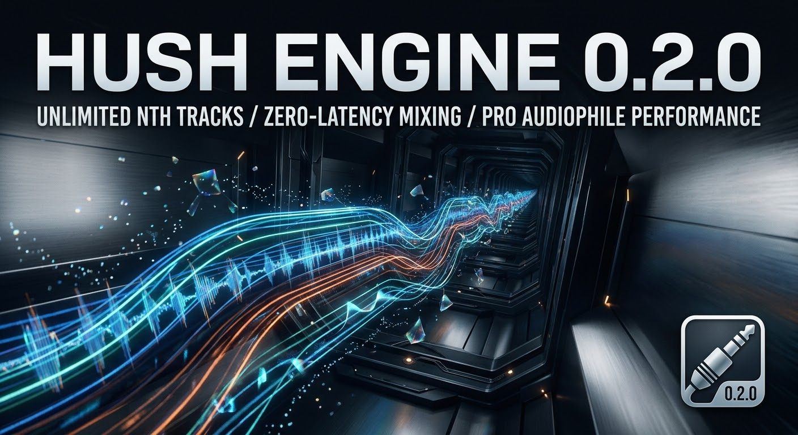

<div align="center">

# HUSH PROCESSOR v0.2.0
### *Zero Telemetry. Deterministic Real-Time Audio Engine.*



[](https://en.cppreference.com/w/cpp/20)
[]()
[]()
[](LICENSE)

</div>

---

# Hush Processor (`HUSH-2.2.0-reconciled`)

[](https://github.com/ljrseals-dev/hush-processor/actions)
[](https://isocpp.org/)
[](LICENSE)

A high-performance C++ audio processing and plugin-hosting engine engineered for real-time audio workflows, comprehensive session management, and robust hardware integration.

---

## 🚀 About the Project

**Hush Processor** is a modular C++ application designed for advanced audio manipulation, real-time monitoring, and extensible plugin management. Built with a focus on low-latency performance, it combines a dedicated PortAudio backend, flexible automation modules, and an X11 graphical interface framework.

---

## ✨ Key Features

* **Advanced Audio Engine**: Low-latency audio processing pipeline backed by PortAudio and modular core components[span_0](start_span)[span_0](end_span).
* **Plugin Hosting**: Dynamic `plugin_host` architecture designed to load, manage, and execute external audio processing plugins seamlessly[span_1](start_span)[span_1](end_span).
* **Comprehensive Core Utilities**: Includes built-in modules for automation, MIDI control, session management, watermarking, forensics, and clipboard integration[span_2](start_span)[span_2](end_span).
* **Graphical User Interface**: Lightweight X11 GUI support (`gui_x11`) for visual interaction and control[span_3](start_span)[span_3](end_span).
* **Rigorous Testing Suite**: Comprehensive unit and integration test coverage verifying audio pipelines, detectors, lanes, and real-time behavior[span_4](start_span)[span_4](end_span).

---

## 📁 Repository Structure

```text
├── .github/workflows/ci.yml     # Continuous Integration workflows
├── src/                         # Core C++ source files
│   ├── audio.cpp / .hpp         # Core audio processing logic
│   ├── audio_engine.cpp / .hpp  # Main audio engine orchestration
│   ├── portaudio_backend.cpp    # PortAudio hardware backend implementation
│   ├── plugin_host.cpp          # Plugin hosting and management system
│   ├── gui_x11.cpp              # X11 graphical user interface module
│   └── main.cpp                 # Application entry point
├── tests/                       # Test suite (audio, detectors, lanes, MSV)
├── CMakeLists.txt               # CMake build configuration
└── *.md                         # Project documentation and historical notes


Here is a professional, production-ready README.md template crafted for the **Hush Processor** repository based on its underlying C++ architecture, audio engine components, and build structure:
```markdown
# Hush Processor (`HUSH-2.2.0-reconciled`)

[](https://github.com/ljrseals-dev/hush-processor/actions)
[](https://isocpp.org/)
[](LICENSE)

A high-performance C++ audio processing and plugin-hosting engine engineered for real-time audio workflows, comprehensive session management, and robust hardware integration.

---

## 🚀 About the Project

**Hush Processor** is a modular C++ application designed for advanced audio manipulation, real-time monitoring, and extensible plugin management. Built with a focus on low-latency performance, it combines a dedicated PortAudio backend, flexible automation modules, and an X11 graphical interface framework.

---

## ✨ Key Features

* **Advanced Audio Engine**: Low-latency audio processing pipeline backed by PortAudio and modular core components[span_0](start_span)[span_0](end_span).
* **Plugin Hosting**: Dynamic `plugin_host` architecture designed to load, manage, and execute external audio processing plugins seamlessly[span_1](start_span)[span_1](end_span).
* **Comprehensive Core Utilities**: Includes built-in modules for automation, MIDI control, session management, watermarking, forensics, and clipboard integration[span_2](start_span)[span_2](end_span).
* **Graphical User Interface**: Lightweight X11 GUI support (`gui_x11`) for visual interaction and control[span_3](start_span)[span_3](end_span).
* **Rigorous Testing Suite**: Comprehensive unit and integration test coverage verifying audio pipelines, detectors, lanes, and real-time behavior[span_4](start_span)[span_4](end_span).

---

## 📁 Repository Structure

```text
├── .github/workflows/ci.yml     # Continuous Integration workflows
├── src/                         # Core C++ source files
│   ├── audio.cpp / .hpp         # Core audio processing logic
│   ├── audio_engine.cpp / .hpp  # Main audio engine orchestration
│   ├── portaudio_backend.cpp    # PortAudio hardware backend implementation
│   ├── plugin_host.cpp          # Plugin hosting and management system
│   ├── gui_x11.cpp              # X11 graphical user interface module
│   └── main.cpp                 # Application entry point
├── tests/                       # Test suite (audio, detectors, lanes, MSV)
├── CMakeLists.txt               # CMake build configuration
└── *.md                         # Project documentation and historical notes

```
## 🛠️ Building & Installation
### Prerequisites
Ensure your system has the following dependencies installed before building:
 * A modern C++ compiler supporting C++17 or later (GCC, Clang, or MSVC)
 * CMake (version 3.15 or higher)
 * PortAudio development libraries (libportaudio2 / portaudio-dev)
 * X11 development headers (for graphical interface support)
### Quick Start
 1. **Clone the repository:**
   ```bash
   git clone [https://github.com/ljrseals-dev/hush-processor.git](https://github.com/ljrseals-dev/hush-processor.git)
   cd hush-processor
   
   ```
 2. **Configure the build with CMake:**
   ```bash
   mkdir build && cd build
   cmake ..
   
   ```
 3. **Compile the application:**
   ```bash
   cmake --build . --config Release
   
   ```
## 🧪 Testing & Quality Assurance
The repository includes a robust testing suite located in the tests/ directory to validate stability, detector calibration, and real-time performance. Run the tests using CTest after building:
```bash
cd build
ctest --output-on-failure

```
## 📚 Documentation
Detailed technical notes, reconciliation history, and build results are available directly in the repository root:
 * MSV_ENGINE_NOTES.md
 * RECONCILIATION.md
 * SECURITY_AND_PRIVACY.md
 * LOCAL_BUILD_RESULTS.md
```

***

Would you like to customize any specific sections of this README, such as adding specific environment setup steps or configuration parameters?

```
